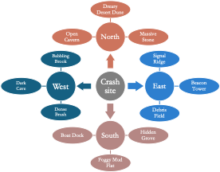
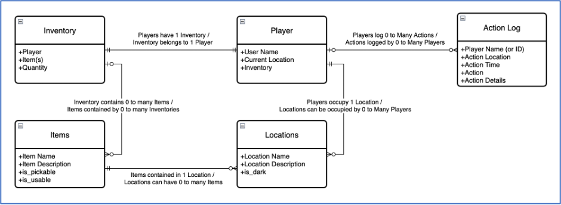
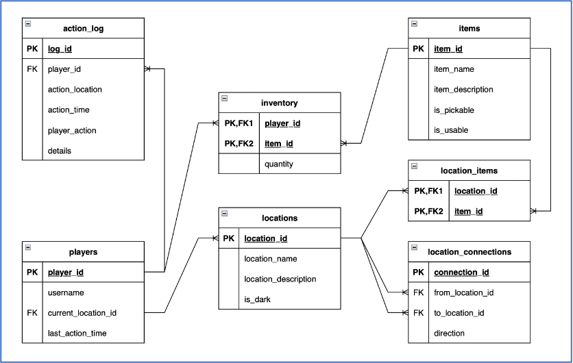
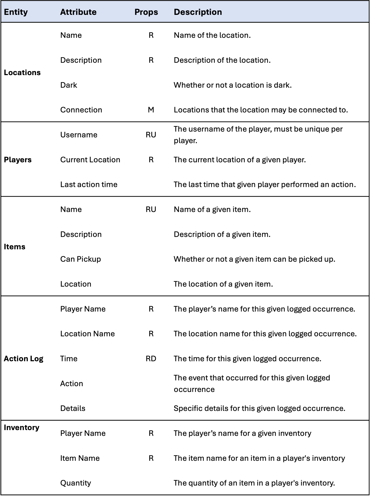
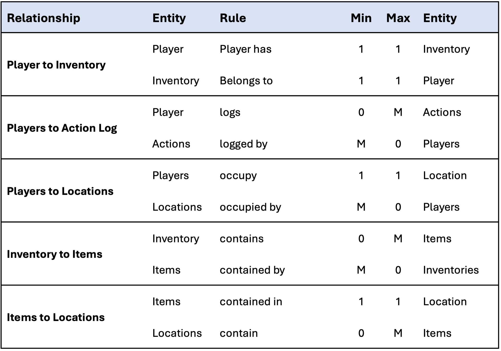

# Starship Command

*A relational database designed to power a text-based science fiction adventure game through SQL-driven gameplay.*

---

## Project Overview

Starship Command is a database design project developed to demonstrate the complete lifecycle of relational database development, from conceptual modeling through physical implementation.  The project explores how a relational database can be used to represent and manage the state of an interactive game world, including locations, player progression, inventory, and gameplay rules.

---

## Project Objectives

- Design and document a conceptual model representing the game world
- Define entity relationships through an entity relationship diagram
- Develop a logical data model containing the entities, attributes and relationships required for implementation
- Implement the database schema using SQL
- Demonstrate gameplay through stored procedures and database-driven game logic

---

## Game Overview

**Starship Command** is a text-based science fiction adventure game in which players must survive after crash-landing on a hostile alien planet.  With their spacecraft heavily damaged and critical systems offline, players must explore the surrounding environment, gather resources and recover the components needed to restore their ship.

Success depends on exploration and careful resource management.  Players navigate interconnected locations, search for supplies and collect the items required to complete their mission.  Each action moves the player closer to repairing the spacecraft and escaping the planet.

Inspired by classic text-based adventure games such as *Oregon Trail*, **Starship Command** combines exploration, resource collection and progression into a simple but engaging gameplay experience.  The objective is straightforward: recover the necessary components, return to the crash site and relaunch the starship.



---

## Database Design

### Conceptual Model

The conceptual model focuses on the key game concepts that need to be implemented for the game to operate.  This diagram maps game rules and restrictions (constraints) to illustrate the relationships between data.



---

### Logical Data Model

The logical model refines the conceptual design by defining attributes, keys, and relationships while remaining independent of any specific database platform.



---

### Entity Relationship Diagram (ERD)

The ERD represents the physical database implementation and illustrates the tables, primary keys, foreign keys and relationships used throughout the application.

#### Entities



#### Relationships



---

## Database Implementation: Modeling a Game World

The foundation of **Starship Command** is a relational database designed to represent and manage an interactive game world.  Rather than storing game state directly in application code, the database defines the game's environment, player progression, inventory and gameplay rules through structured tables, relationships, stored procedures and constraints.

### Game World and Locations

The game map is represented through a `Locations` table containing the name and description of each area available for exploration.  To create movement between locations, a bridge table defines valid connections by mapping location relationships in a `From/To` pattern.

This approach allows the game world to be expanded by adding new locations and connections without requiring changes to the underlying gameplay logic.

### Items and Inventory Management

Items required for completing the mission are stored in an `Items` table, with each item containing a name and description aligned with the game's objectives.  Items are placed throughout the world using a mapping table that establishes relationships between items and locations.

When a player explores a location, available items are returned through gameplay logic that allows the player to collect and store them in their inventory.  Players must successfully recover the required components to complete the mission and relaunch their spacecraft.

### Player State Management

Each player is represented by a unique `Player ID` that connects the player to their current location, inventory and gameplay history.  The player table maintains key game state information, including:

* Username
* Current location
* Last action timestamp

The Player ID serves as the primary identifier required for executing gameplay operations.

### Inventory and Gameplay Tracking

The `Inventory` table manages the many-to-many relationship between players and collected items.  This design supports multiple players, with each player maintaining an independent inventory and progression state.

An `Action Log` table records gameplay activity, including:

* Player ID
* Action performed
* Location
* Date and time of the event

This audit history supports debugging, gameplay analysis and future enhancements by providing visibility into player behavior.

---

## Database Schema Creation

The database build script defines the physical schema required to support gameplay.  The implementation includes seven tables and sixteen constraints that establish the required relationships and enforce data integrity.

Key database elements include:

* Primary keys for entity identification
* Foreign keys to maintain relationships
* Constraints to enforce valid game states
* Structured relationships between players, locations, items, and gameplay events

---

## Data Population

The initial game world is populated through SQL insert statements that create the locations, items, players and supporting relationships required for gameplay.

The current game map contains:

* 5 primary locations
* 3 sub-locations per primary location
* 17 total explorable locations

The design is intentionally scalable.  Expanding the game world requires only adding new location records and connection mappings.  Additional items can be introduced through independent inserts without requiring changes to the existing database structure.

---

## CRUD Operations and Stored Procedures

Five stored procedures implement the primary gameplay actions by performing database operations required for player interaction.  Each procedure manages a specific game function while maintaining database integrity.

Examples of supported actions include:

* Moving between locations
* Looking around an area
* Collecting items
* Updating player state
* Recording gameplay events

For example, `usp_movePlayer` accepts a player ID and movement direction, validates the requested action and updates the player's current location within the game map.

---

## Triggers and Automated Validation

Triggers were implemented to enforce game rules, automate logging and reduce duplicate logic across stored procedures.

### Player Movement Logging (`trg_players_move_log`)

Automatically records player movement events whenever a player's location changes, capturing the player ID, destination location and timestamp.

### Inventory Audit (`trg_inventory_audit`)

Tracks item additions and removals from player inventories by writing corresponding events to the action log.

### Inventory Validation (`trg_inventory_validate`)

Enforces item collection rules by preventing invalid inventory states, including:

* Collecting items that are not available for pickup
* Creating duplicate item quantities for a player

Together, these triggers centralize validation logic, improve maintainability, and ensure consistent enforcement of gameplay rules throughout the database.


---

## Repository Structure

```text
sql/
├── 01_build_database.sql
└── 02_gameplay.sql

docs/
├── conceptual_model.png
├── logical_data_model.png
├── erd_ent.png
├── erd_rel.png
└── game_map.png
```

---

## Getting Started

1. Execute `01_build_database.sql` to create the database schema.
2. Execute `02_gameplay.sql` to populate the database and demonstrate gameplay.

---

## Gameplay

After the database build script has been executed, players interact with **Starship Command** through stored procedures that control movement, exploration, item collection, and mission completion.

The game begins with the player stranded on an alien planet after a spacecraft crash. The objective is to explore the surrounding area, recover the four missing components required to repair the ship, and return to the crash site to relaunch the spacecraft.

### Starting the Game

The build script creates an initial player record:

```sql
@player_id = 1
```

This player ID is used throughout gameplay commands.

### Exploring the World

To view the player's current location and available actions:

```sql
EXEC usp_lookAround @player_id = 1;
```

The player begins at the spacecraft crash site and must explore connected locations to discover resources and mission-critical items.

### Moving Between Locations

Players navigate the game world using directional commands:

```sql
EXEC usp_movePlayer 
    @player_id = 1,
    @direction = 'east';
```

After moving, players can run `usp_lookAround` again to view their new location, description, and any available items.

### Collecting Items

When a required component is discovered, players can add it to their inventory:

```sql
EXEC usp_pickUpItem 
    @player_id = 1,
    @item_id = <item_id>;
```

Available item IDs are returned by `usp_lookAround` when an item is present at the current location.

### Completing the Mission

Once all four required components have been collected, the player must return to the crash site and attempt to repair the spacecraft:

```sql
EXEC usp_completeGame @player_id = 1;
```

If all required items have been collected, the player successfully completes the mission and relaunches the starship. If items are missing, the procedure provides hints about the remaining components and where they can be found.

---

## Technologies

* SQL
* Relational Database Design
* Entity Relationship Modeling
* Database Normalization

---

## Lessons Learned

This project provided experience designing a complete database-backed application from requirements through implementation.

Key lessons learned:  
- Strong data modeling is foundational to application design.  A well-designed schema simplifies application logic and improves scalability
- Relational databases can support dynamic application behavior through stored procedures, triggers and constraints
- Requirements evolve during development, requiring teams to balance desired functionality with project scope
- Collaboration and version control become increasingly important as technical complexity grows

---

## Future Enhancements

Potential future improvements include:

- Build a Flask-based web interface to replace terminal gameplay
- Add user authentication and persistent player profiles
- Introduce randomized maps and item placement
- Add game scoring and achievement tracking
- Create analytics dashboards using player action logs
- Migrate the architecture to a cloud database platform

---

## Project Contributors

**Starship Command** was developed as a collaborative database design project.  I contributed to the database design, SQL implementation, documentation and gameplay development alongside my project teammates.

Contributors:
- Robert Nitto
- Jeong Hwan Son
- Darrell Collison
- Tristan Morlock

---

## License

This project is licensed under the MIT License. See the [LICENSE](LICENSE) file for details.